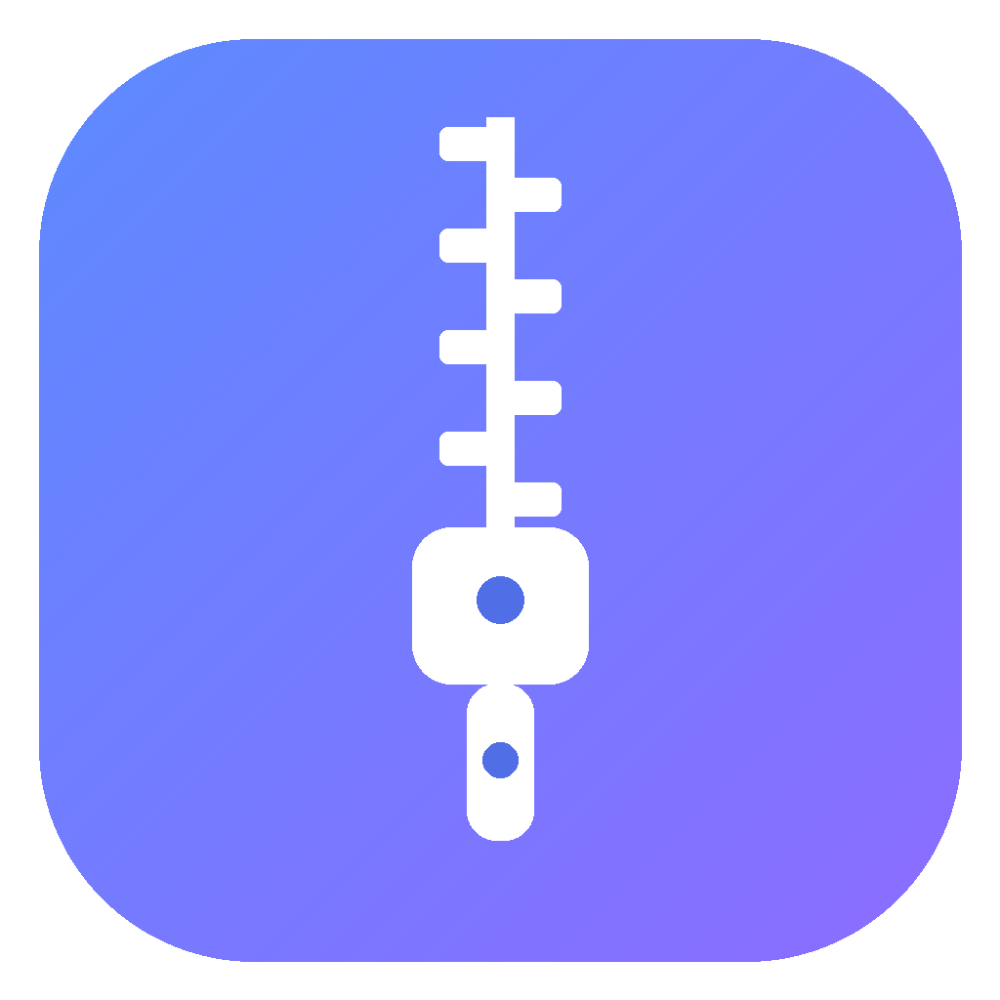

<div align="center">



# Smart Zipper

### Pack your project for AI — only what matters, nothing you don't.

Pick a folder, see exactly where the bytes live, filter out the noise, and export a clean **ZIP** or a single **Markdown** file ready to paste into ChatGPT, Claude, Gemini, DeepSeek, or Llama.


</div>

---

## Why?

AI chats have limits: file size, context window, and your patience. Zipping a whole repo drags in `node_modules`, build output, lock files, secrets, and binaries — which wastes tokens and can leak credentials.

**Smart Zipper** lets you review everything first, then export only what's useful.

## Features

| | |
|---|---|
| 🌳 **Folder tree with sizes** | Expand/collapse, tri-state checkboxes, and an animated size bar per item showing its share of the parent. |
| 🎯 **One-click presets** | *Code only* (source files, no build output, locks, minified files, or source maps) or *All files*. |
| 🚫 **Transparent ignoring** | Every excluded file is listed with its **reason**: manual, secret, preset, tests, `.gitignore`, big file, pattern, extension, size, date. |
| 🔐 **Secret protection** | `.env`, keys, and credentials are excluded by default. You can override this manually. |
| ⚙ **Advanced filters** | Ignore patterns, allowed extensions, min/max size (MB), and date range. |
| 📏 **Token estimates** | Live estimates for GPT-4o, Claude, Gemini, Llama 3, and DeepSeek, so you know if it fits before you send it. |
| 👁 **Instant preview** | Click any file to read its first 60 KB without leaving the app. |
| 📦 **ZIP export** | Adjustable compression level and an optional `STRUCTURE.txt` project map. |
| 📝 **Markdown export** | The whole project in one `.md` file with a directory tree and fenced code blocks, for AI tools that don't accept ZIPs. |
| ✨ **Animated progress** | Live scan counter and a smooth export progress bar. |
| 🌍 **Bilingual UI** | English (default) and Persian with full RTL, switchable at any time. |
| 🕘 **Recent projects** | Drag and drop a folder or pick one from your history. |

## Quick start

```bash
git clone https://github.com/RasolAlibakhshi/Smart-Zipper.git 
cd smart-zipper
npm install
npm start
```

Requires [Node.js](https://nodejs.org) 18+.

## Usage

1. **Open** a project: drag a folder onto the window or click to browse.
2. **Choose a preset**: *Code only* is the best starting point for AI.
3. **Refine**: untick folders, search, or open **⚙ Advanced** for patterns, extensions, size, and dates.
4. **Check the sidebar**: see what's ignored (and why), the total size, and the token estimates.
5. **Export** as ZIP or Markdown.

## Build installers

```bash
npm run dist:win     # NSIS installer + portable .exe  → dist/
npm run dist:linux   # AppImage + .deb                 → dist/
npm run dist         # both
```

- Building the Windows target on Linux needs `wine`. Building each target on its own OS is easiest.
- Make the AppImage executable first: `chmod +x SmartZipper-*.AppImage`.
- Icons live in `build/` (`icon.png`, `icon.ico`).

## Project structure

```
smart-zipper/
├── build/            # app icons (png, ico)
├── src/
│   ├── main.js       # Electron main process: scan, read, export (ZIP/MD)
│   ├── preload.js    # secure IPC bridge (contextBridge)
│   ├── index.html    # UI markup
│   ├── renderer.js   # tree, filters, i18n, token estimates
│   └── style.css     # dark theme and animations
└── package.json      # scripts and electron-builder config
```

## Under the hood

- **Safe by design:** context isolation is on, Node integration is off, and a strict CSP is set. File reads are confined to the opened folder.
- **Fast scanning:** files in each directory are stat'ed in parallel, and the UI gets throttled progress updates.
- **Streaming exports:** ZIP and Markdown are written as streams, so large projects don't blow up memory.
- **Token estimate:** roughly 3.6 bytes per token for text; binary files count as zero. It's a guide, not an exact tokenizer.

## Known limitations

- `.gitignore` parsing is simplified (no `!` negation).
- Changing a preset or filter resets your manual checkbox overrides.
- Markdown export skips binary files.

## License

MIT

---

<div align="center">

### 🤖 Vibe Coded

This app was **vibe coded**. Every line was written by an AI model, **Claude** (by Anthropic), running inside the *pi* coding agent.

**Idea & direction:** the app's author (idea giver) — flax.rasolabz2@gmail.com

</div>
